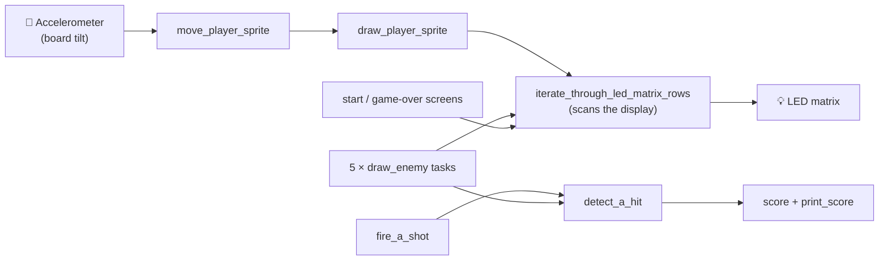
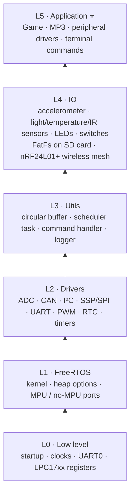

<div align="center">

# 🛡️ Spartan-Warrior

### An LED-matrix space shooter and MP3 audio system, running on bare-metal FreeRTOS


-red?style=for-the-badge)

**Embedded systems project · San Jose State University · Fall 2018**

[📄 Project report](http://socialledge.com/sjsu/index.php/F18:_Spartan_Warrior)

</div>

---

## ✨ Overview

Spartan-Warrior is an embedded entertainment system built on the **SJOne board** (NXP LPC1758, ARM Cortex-M3). It has two firmware builds that share one hardware and software stack:

| Firmware | What it does |
|---|---|
| 🎮 **Game Firmware** | A multi-task **space shooter** drawn on an LED matrix. Tilt the board to steer your ship, fire at the enemies, and chase a score. It has start and game-over screens and a play-again option |
| 🎵 **MP3 Firmware** | Plays audio through an SPI-connected MP3 decoder, using a `Mp3Decoder` class that wraps the decoder's registers (mode, clock, volume, bass, audio data) |

The original project goals were an embedded music system: a playlist stored on an SD card, decoded and played through a speaker, controlled remotely from a phone over Bluetooth, with the audio spectrum shown on RGB LEDs. See the report for the full story.

## 🎮 The game

Everything in the game is its own **FreeRTOS task**, which makes it a neat study in cooperative real-time design:



- 📐 **Tilt controls**: the onboard accelerometer's Y axis is read, bucketed into steps and mapped to ship movement
- 👾 **Five enemies**, each in its own task, worth between 1 and 7 points
- 💥 **Hit detection** runs as its own task
- 🖥️ **Display scanning** is done by dedicated row-iteration tasks, with separate ones for the start/end screens

## 🧱 Software architecture

The project uses the layered SJSU framework. The lower layers are the course-provided base, and the project's own work is in `L5_Application`.



## 📁 Repository layout

```text
Spartan-Warrior/
└── Spartan_Warrior/
    ├── L0_LowLevel/ … L4_IO/        # SJSU framework layers
    ├── L5_Application/              # ⭐ project code
    │   ├── Game Firmware/           #   LED-matrix shooter
    │   ├── MP3 Firmware/            #   Mp3Decoder, mp3_main, test song
    │   ├── Peripheral Drivers/      #   LabGPIO, GPIO interrupts, LabSPI
    │   └── source/                  #   terminal, remote, command handlers
    ├── _cgreen_test/                # host-side unit tests (Cgreen)
    ├── loader.ld  loader_mpu.ld     # linker scripts
    ├── dox.Doxyfile                 # Doxygen configuration
    └── .project  .cproject          # Eclipse CDT project
```

## 🚀 Building

The repository is an **Eclipse CDT project** for the SJOne board, so the quickest way in is:

1. `git clone https://github.com/tanmayhc7/Spartan-Warrior.git`
2. In Eclipse (with the ARM GCC toolchain installed): **File → Import → Existing Projects into Workspace** and choose the `Spartan_Warrior` folder
3. `L5_Application` holds both firmwares (Game and MP3), so make sure the one you want is the one included in the build
4. Build and flash to the SJOne board

> Full hardware setup, wiring and results are in the [project report](http://socialledge.com/sjsu/index.php/F18:_Spartan_Warrior).

## 🛠️ Tech stack

`C++ / C` · `FreeRTOS` · `LPC1758 / Cortex-M3` · `SPI` · `GPIO interrupts` · `LED-matrix driving` · `MP3 decoding` · `Accelerometer input` · `Eclipse CDT`

---

<div align="center">

Built by [Tanmay Chandavarkar](https://github.com/tanmayhc7) with the Spartan-Warrior team · Framework by Prof. Preet Kang, SJSU

</div>
